# Comment fonctionnent les requêtes

> Généré par `python questions.py --doc` à partir de `requetes/questions.cypher`
> (lignes `@simple` et `@etape`) — ne pas modifier à la main.

Ce document explique chaque question deux fois : **en clair**, pour quelqu'un qui ne
connaît ni les bases de données ni la programmation, puis **étape par étape**, avec ce
que la requête parcourt et les filtres qu'elle applique.

## Lire un graphe en cinq minutes

La base n'est pas un tableau Excel, mais un **graphe** : un dessin fait de points et de
flèches.

- Un **nœud** est une chose : un pilote (`Driver`), une écurie (`Constructor`), une
  course (`Race`), une saison (`Season`), une académie de jeunes pilotes (`Academy`)…
- Une **relation** est une flèche qui relie deux nœuds et dit comment ils sont liés :
  `Max Verstappen —DROVE_FOR→ Red Bull` se lit « Max Verstappen a couru pour Red Bull ».
- Les nœuds et les flèches portent des **propriétés** : la date d'une course, la saison
  d'un engagement, les points d'un résultat.

Les flèches les plus utilisées :

| Flèche | Se lit |
|---|---|
| `Driver —DROVE_FOR {season}→ Constructor` | le pilote a couru pour cette écurie, cette saison-là |
| `RaceResult —IN_RACE→ Race`, `—OF_DRIVER→ Driver` | ce résultat est celui de ce pilote, dans cette course |
| `Driver —TEAMMATE_OF→ Driver` | ces deux pilotes ont été coéquipiers (même écurie, même saison) |
| `Driver —MEMBER_OF→ Academy` | le pilote a été formé dans cette académie, de telle année à telle année |
| `Driver —RANKED_IN→ Season` | sa place au classement final de la saison |
| `Newsroom —FOLLOWS→ Driver` | la rédaction suit ce pilote |

## Lire une requête : six mots suffisent

Une requête (langage **Cypher**) décrit un petit dessin à chercher dans le grand graphe,
puis ce qu'on en garde.

| Mot | Ce qu'il fait | Exemple en clair |
|---|---|---|
| `MATCH` | **cherche** un motif : des nœuds reliés par des flèches | « trouve les pilotes qui ont couru pour une écurie » |
| `WHERE` | **filtre** : ne garde que ce qui respecte une condition | « … seulement en 2026 » |
| `WITH` | passe à l'**étape suivante** en ne gardant que certaines informations | « avec ces pilotes, maintenant… » |
| `RETURN` | **affiche** le résultat | « montre le nom et le nombre de victoires » |
| `ORDER BY` / `LIMIT` | **trie**, puis ne garde que les premiers | « les 10 meilleurs » |
| `count`, `sum`, `collect` | **compte**, **additionne**, **rassemble en liste** | « nombre de courses ensemble » |

Quelques formes reviennent souvent :

- `(a)-[:TEAMMATE_OF]-(b)` : un motif ; les parenthèses sont des nœuds, les crochets des
  flèches ;
- `EXISTS { … }` / `NOT EXISTS { … }` : « il existe » / « il n'existe pas » un tel motif ;
- `shortestPath(…)` : le plus court chemin entre deux nœuds, comme un trajet sur une carte ;
- `$saison`, `$a` : des **paramètres**, c'est-à-dire des valeurs remplies avant l'exécution.
  Chaque question commence souvent par une **prérequête**, qui va chercher dans la base
  une valeur utile (la dernière saison, les deux premiers du championnat…).

Dans l'interface web (page « Questions »), le volet « Comprendre la requête » dessine ces
étapes, et le **plan d'exécution** montre ce que Neo4j fait réellement, opérateur par
opérateur (en orange, les filtres).

---

## Q1 — What recent event has left its mark on the world of F1 over the last few weeks? Who took part in the races during this event, and what were the results?

**En clair.** On cherche le dernier Grand Prix couru, puis toutes les courses des quatre semaines qui le précèdent (la période s'allonge pendant l'hiver, quand il n'y a pas de course). Pour chaque course, on relève ce qui sort de l'ordinaire : un pilote qui gagne pour la première fois, une victoire partie de loin sur la grille, un changement de leader au championnat, beaucoup d'abandons. La course qui cumule le plus de ces faits arrive en tête, avec la liste complète des pilotes et de leurs résultats.

*Couverture : complète. Fenêtre : les $semaines semaines qui précèdent le dernier Grand Prix disputé, jusqu'à aujourd'hui — elle s'allonge d'elle-même pendant l'intersaison. Les Grands Prix de la fenêtre sont classés par nombre de faits marquants (première victoire, victoire partie loin, changement de leader au championnat, hécatombe d'abandons), puis du plus récent au plus ancien : la première ligne est l'événement qui a le plus marqué.*

**Étape par étape.**

| Étape | Parcourt | Filtres |
|---|---|---|
| 1. Fenêtre de temps | `(prérequête) Race` | date ≤ aujourd'hui ET au moins un RaceResult ; dernier = max(date) ; début = dernier − $semaines semaines |
| 2. Grands Prix de la fenêtre | `(Race)-[:HELD_AT]->(Circuit)` | $debut ≤ date ≤ $fin ET course disputée (EXISTS RaceResult) |
| 3. Vainqueur | `(Race)<-[:IN_RACE]-(RaceResult)-[:OF_DRIVER]->(Driver)` | position = 1 |
| 4. Leader avant et après | `sous-requête : (Driver)<-[:OF_DRIVER]-(résultat)-[:IN_RACE]->(Race de la même saison)` | RaceResult OU SprintResult ; manche ≤ manche courante ; somme des points, tri décroissant, premier |
| 5. Faits marquants | `vainqueur, grille, abandons` | aucune victoire antérieure du vainqueur ; grille ≥ $depart_lointain ; leader avant ≠ leader après ; non classés ≥ $abandons_nombreux |
| 6. Participants et classement | `(Race)<-[:IN_RACE]-(RaceResult)-[:OF_DRIVER, FOR_CONSTRUCTOR, WITH_STATUS]` | tri par position ; puis Grands Prix triés par nombre de faits, puis date décroissante |

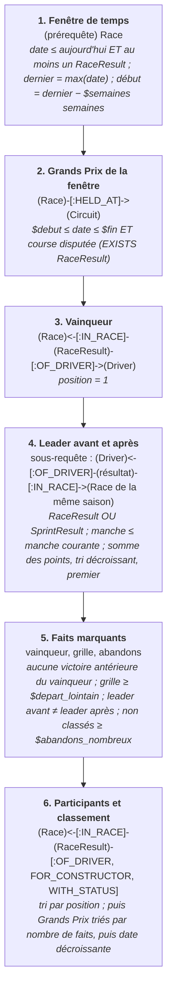

## Q2 — Which opponents are facing each other again, and what is their head-to-head record?

**En clair.** On prend la prochaine course au calendrier et les pilotes de cette saison. Pour chaque paire de pilotes, on retrouve toutes les courses qu'ils ont disputées ensemble, et on compte combien de fois chacun a fini devant l'autre. Les paires qui se sont affrontées le plus souvent apparaissent en premier.

*Couverture : complète, à une approximation près : l'API ne publie pas la liste des engagés d'une course future ; la grille retenue est celle de la saison de la prochaine course (ou de la dernière, pendant l'intersaison). Face-à-face = courses disputées par les deux ; devant = mieux classé (abandons compris).*

**Étape par étape.**

| Étape | Parcourt | Filtres |
|---|---|---|
| 1. Course de référence | `(prérequête) Race` | prochaine course : date ≥ aujourd'hui SANS résultat, tri par date, LIMIT 1 ; à défaut la dernière disputée |
| 2. Grille | `(Driver)-[:DROVE_FOR]->(Constructor)` | DROVE_FOR.season = $saison_grille |
| 3. Paires d'adversaires | `grille × grille` | a.driverId < b.driverId (chaque paire une fois) ; $a, $b s'ils sont donnés |
| 4. Courses communes | `(a)<-[:OF_DRIVER]-(RaceResult)-[:IN_RACE]->(Race)<-[:IN_RACE]-(RaceResult)-[:OF_DRIVER]->(b)` | date de la course < $date_ref |
| 5. Bilan | `comptage par paire` | devant = position inférieure ; tri par nombre de courses communes ; LIMIT 25 |

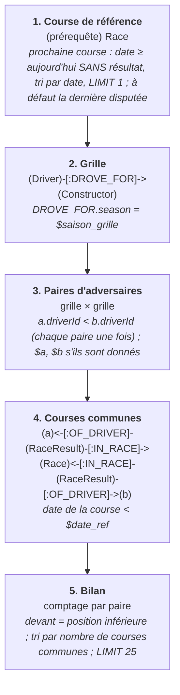

## Q3 — Which participants are facing a former team or former teammates?

**En clair.** Pour chaque pilote de la saison, on regarde son passé : les écuries où il a couru, et les pilotes qui ont été ses coéquipiers. On ne garde que ceux qu'il va affronter : une ancienne écurie toujours en course, ou un ancien coéquipier qui roule maintenant pour une autre écurie.

*Couverture : complète. Pour chaque pilote de la grille retenue : ses anciennes écuries encore engagées contre lui, et ses anciens coéquipiers désormais dans une autre écurie que la sienne.*

**Étape par étape.**

| Étape | Parcourt | Filtres |
|---|---|---|
| 1. Course de référence | `(prérequête) Race` | comme Q2 : prochaine course, à défaut la dernière disputée |
| 2. Pilote et écurie actuelle | `(Driver)-[:DROVE_FOR]->(Constructor)` | DROVE_FOR.season = $saison_grille |
| 3. Anciennes écuries adverses | `(Driver)-[:DROVE_FOR]->(Constructor)` | saison < $saison_grille ; écurie ≠ actuelle ; écurie engagée cette saison (EXISTS DROVE_FOR $saison_grille) |
| 4. Anciens coéquipiers adverses | `(Driver)-[:DROVE_FOR]->(Constructor)<-[:DROVE_FOR]-(Driver)` | même saison ; saison < $saison_grille ; coéquipier engagé cette saison ; PAS dans l'écurie actuelle |
| 5. Résultat | `une ligne par pilote` | au moins une ancienne écurie OU un ancien coéquipier adverse |

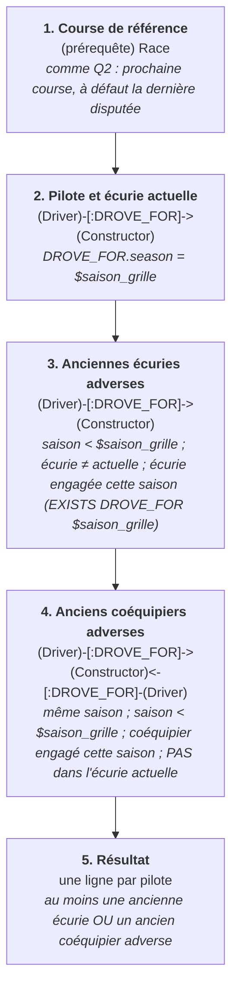

## Q4 — Who has moved up or down in the rankings since the previous week?

**En clair.** On refait le classement du championnat deux fois, en additionnant les points de chaque pilote : après l'avant-dernière course, puis après la dernière. On compare les deux places : un nombre positif veut dire que le pilote est monté. La colonne « rang officiel » vérifie que le calcul retrouve bien le classement officiel.

*Couverture : complète pour la saison en cours. « Semaine précédente » = manche précédente. Le classement est recalculé (points de course et de sprint cumulés) : l'API ne publie que le classement après la dernière manche, rapporté en regard (rang_officiel) pour contrôle. Égalité de points : départage au nombre de meilleures places en Grand Prix (victoires, puis deuxièmes places…), arrivées classées seulement. Avant 1991, les résultats décomptés font diverger ce calcul.*

**Étape par étape.**

| Étape | Parcourt | Filtres |
|---|---|---|
| 1. Saison | `(prérequête) Race` | course disputée ; saisons d'au moins 2 manches ; la plus récente |
| 2. Deux manches comparées | `Race de la saison` | dernière manche disputée, et la précédente |
| 3. Points cumulés | `(Driver)<-[:OF_DRIVER]-(résultat)-[:IN_RACE]->(Race)` | RaceResult OU SprintResult ; manche ≤ manche comparée |
| 4. Classement | `tri` | points décroissants, puis nombre de victoires, de 2es places… (positions classées seulement) |
| 5. Évolution | `rang avant − rang après` | rang officiel lu dans RANKED_IN si afterRound = dernière manche |

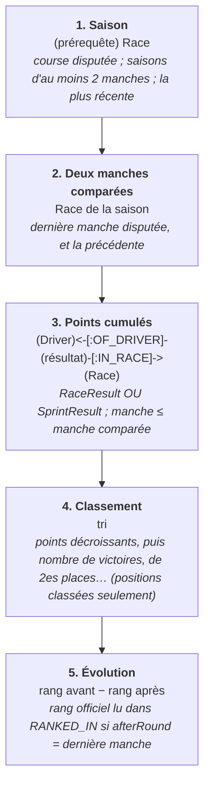

## Q5 — Which athletes have had the same coach, and during the same period?

**En clair.** En F1, l'équivalent d'un entraîneur commun est une académie de pilotes : l'école de jeunes pilotes d'une écurie (Red Bull, Ferrari…). On cherche les paires de pilotes passés par la même académie, et les années pendant lesquelles ils y étaient en même temps.

*Couverture : complète, par substitution. « Même entraîneur » = même ACADÉMIE de pilotes (Wikipédia) ; « même période » = années d'adhésion qui se chevauchent. Une adhésion en cours compte jusqu'à l'année courante. Les coéquipiers (même écurie, même saison) sont l'autre équivalent : relation TEAMMATE_OF, question 16.*

**Étape par étape.**

| Étape | Parcourt | Filtres |
|---|---|---|
| 1. Adhésions | `(Driver)-[:MEMBER_OF]->(Academy)<-[:MEMBER_OF]-(Driver)` | a.driverId < b.driverId (chaque paire une fois) |
| 2. Période commune | `années de début et de fin` | début commun = max(débuts) ; fin commune = min(fins, en cours = année courante) ; début commun ≤ fin commune |
| 3. Résultat | `une ligne par paire et académie` | tri par durée commune décroissante ; LIMIT 30 |

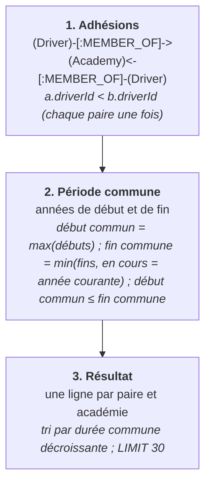

## Q6 — Which upcoming events involve participants followed by the newsroom?

**En clair.** La rédaction a déclaré qui elle suit : Max Verstappen, Isack Hadjar et l'écurie Red Bull. On prend les trois prochaines courses au calendrier et on indique, pour chacune, lesquels de ces pilotes et écuries y prennent part.

*Couverture : complète, dès que la rédaction renseigne referentiel/suivis.csv (pilotes ou écuries qu'elle suit). Sans suivi déclaré, la réponse est vide : rien n'est deviné. Engagés d'une course future = pilotes et écuries de sa saison, l'API ne publiant pas la liste des engagés.*

**Étape par étape.**

| Étape | Parcourt | Filtres |
|---|---|---|
| 1. Suivis | `(prérequête) (Newsroom)-[:FOLLOWS]->(Driver ou Constructor)` | comptage : 0 = referentiel/suivis.csv vide |
| 2. Prochaines courses | `Race` | date ≥ aujourd'hui ET aucun résultat ; tri par date ; LIMIT $prochaines |
| 3. Suivis engagés | `(Newsroom)-[:FOLLOWS]->(x)` | pilote : DROVE_FOR de la saison de la course ; écurie : au moins un pilote engagé cette saison |
| 4. Résultat | `une ligne par course` | au moins un suivi engagé ; tri par date |

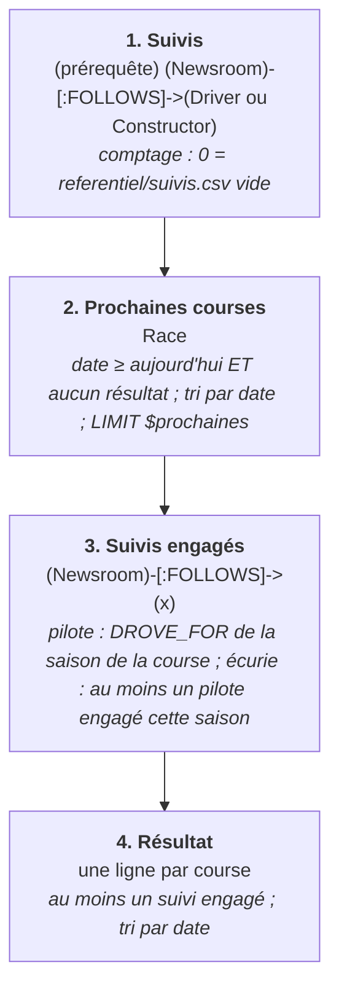

## Q7 — Who has performed best against the highest-ranked opponents at the time of the match?

**En clair.** Avant chaque course, on calcule qui sont les trois premiers du championnat à ce moment-là : les favoris. Puis on compte, pour chaque pilote, combien de fois il a fini devant l'un d'eux. Le classement donne le pourcentage de ces « duels » gagnés contre les meilleurs, sur les cinq dernières saisons.

*Couverture : complète. « Les mieux classés au moment du match » = les $top premiers au championnat recalculé avant la course (manches précédentes de la saison). Duel gagné = arrivée devant l'un d'eux. Première manche exclue (pas encore de classement). Un pilote doit compter au moins $duels_min duels.*

**Étape par étape.**

| Étape | Parcourt | Filtres |
|---|---|---|
| 1. Période | `(prérequête) Race` | les cinq dernières saisons disputées |
| 2. Courses | `Race` | $de ≤ saison ≤ $a ; manche > 1 ; course disputée |
| 3. Favoris au départ | `sous-requête : points cumulés AVANT la course` | manches < manche courante ; tri décroissant ; LIMIT $top |
| 4. Duels | `(Race)<-[:IN_RACE]-(RaceResult)-[:OF_DRIVER]->(Driver) × favoris` | favori ≠ pilote lui-même ; duel gagné = position < position du favori |
| 5. Résultat | `par pilote` | duels ≥ $duels_min ; tri par % de duels gagnés ; LIMIT 15 |

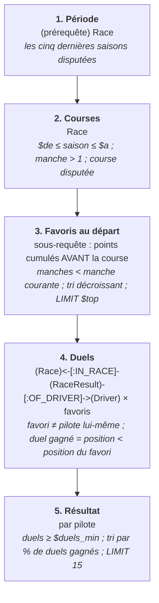

## Q8 — Which participants are facing a former team or former teammates?

**En clair.** Même question que la 3 : voir son explication.

*Doublon de la question 3 : même requête, voir Q3.*

## Q9 — What transfers or coaching changes have been announced, and when do they take effect?

**En clair.** On compare la saison actuelle à la précédente. Un pilote qui roule pour une nouvelle écurie a été transféré ; la date retenue est celle de sa première course avec elle. On ajoute les pilotes entrés dans une académie cette année, ou sortis l'an dernier. Les dates d'annonce ne sont pas connues : seulement la date où le changement a pris effet.

*Couverture : PARTIELLE. Pas de dates d'annonce dans les sources : seuls les changements EFFECTIFS sont connus. Transferts : nouvelle écurie, datée par la première course disputée avec elle. Changements d'encadrement : entrées dans une académie l'année $saison et sorties à la fin de l'année précédente (Wikipédia, à l'année près).*

**Étape par étape.**

| Étape | Parcourt | Filtres |
|---|---|---|
| 1. Saison | `(prérequête) Race` | dernière saison disputée |
| 2. Transferts | `(Driver)-[:DROVE_FOR]->(Constructor)` | DROVE_FOR.season = $saison ET pas de DROVE_FOR vers cette écurie en $saison − 1 |
| 3. Date d'effet du transfert | `(Driver)<-[:OF_DRIVER]-(résultat)-[:FOR_CONSTRUCTOR]->(nouvelle écurie)` | course de $saison ; tri par date ; LIMIT 1 |
| 4. Entrées en académie | `(Driver)-[:MEMBER_OF]->(Academy)` | fromYear = $saison |
| 5. Sorties d'académie | `(Driver)-[:MEMBER_OF]->(Academy)` | toYear = $saison − 1 |
| 6. Résultat | `UNION ALL des trois listes` | tri par date d'effet |

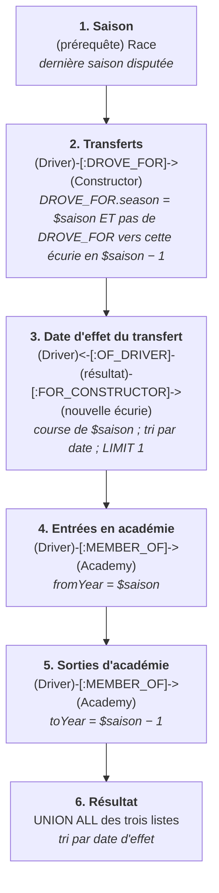

## Q10 — If a coach is removed from the network, which players or groups become disconnected?

**En clair.** Que se passerait-il si une écurie disparaissait ? On compte les pilotes qui n'ont jamais couru que pour elle (ils perdraient tout lien avec les autres pilotes) et les paires de coéquipiers qu'elle seule avait réunies. L'écurie étudiée est choisie automatiquement : celle dont la disparition aurait le plus d'effet.

*Couverture : PARTIELLE, par analogie. L'encadrement retenu est l'ÉCURIE : la retirer coupe du réseau des coéquipiers les pilotes qui n'ont couru que pour elle, et défait les binômes qu'elle seule réunissait. Les académies ne relient pas les pilotes entre eux dans ce réseau : les retirer n'isolerait personne.*

**Étape par étape.**

| Étape | Parcourt | Filtres |
|---|---|---|
| 1. Écurie retirée | `(prérequête) (Driver)-[:DROVE_FOR]->(Constructor)` | pilotes n'ayant couru que pour UNE écurie ; l'écurie qui en compte le plus |
| 2. Pilotes isolés | `(Driver)-[:DROVE_FOR]->(écurie)` | AUCUN DROVE_FOR vers une autre écurie |
| 3. Binômes défaits | `(a)-[:DROVE_FOR]->(écurie)<-[:DROVE_FOR]-(b)` | même saison ; a.driverId < b.driverId ; jamais coéquipiers dans une autre écurie |

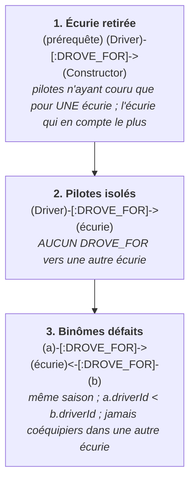

## Q11 — Which players are indirectly connected through their career paths, without having attended the same academy or shared a coach?

**En clair.** Deux pilotes sont « reliés indirectement » quand ils ont eu un coéquipier en commun sans jamais avoir été coéquipiers eux-mêmes, comme deux personnes qui ont un ami commun. On écarte ceux qui sont passés par la même académie. Le résultat montre, pour un pilote donné, qui lui est relié et par l'intermédiaire de qui.

*Couverture : complète, par substitution. Reliés indirectement = un coéquipier commun (TEAMMATE_OF à deux pas). Exclus : les pilotes déjà coéquipiers (même encadrement d'écurie) et ceux passés par une même académie, à n'importe quelle époque.*

**Étape par étape.**

| Étape | Parcourt | Filtres |
|---|---|---|
| 1. Pilote de départ | `(prérequête) (Driver)-[:DROVE_FOR]->(Constructor)` | grille de la dernière saison ; le plus de coéquipiers distincts |
| 2. Deux pas de coéquipiers | `(a)-[:TEAMMATE_OF]-(m)-[:TEAMMATE_OF]-(b)` | b ≠ a |
| 3. Pas d'encadrement commun | `NOT EXISTS (a)-[:TEAMMATE_OF]-(b)` | jamais coéquipiers |
| 4. Pas d'académie commune | `NOT EXISTS (a)-[:MEMBER_OF]->(Academy)<-[:MEMBER_OF]-(b)` | aucune académie en commun |
| 5. Résultat | `par pilote relié` | intermédiaires collectés ; tri par nombre d'intermédiaires ; LIMIT 25 |

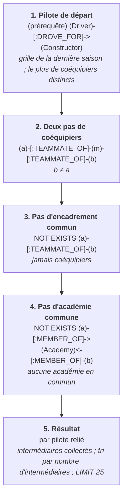

## Q12 — Which coaches connect players from different academies?

**En clair.** Pendant une saison, une écurie encadre ses pilotes. On cherche les écuries qui, une même saison, ont fait courir des pilotes formés dans des académies différentes : elles font le pont entre ces académies.

*Couverture : complète, par substitution. « Entraîneur » = encadrement de course : l'ÉCURIE D'UNE SAISON. Elle relie des académies quand elle fait courir, la même saison, des pilotes formés dans des académies différentes (adhésion commencée avant ou pendant cette saison).*

**Étape par étape.**

| Étape | Parcourt | Filtres |
|---|---|---|
| 1. Pilotes engagés | `(Driver)-[:DROVE_FOR]->(Constructor)` | toutes saisons |
| 2. Formation | `(Driver)-[:MEMBER_OF]->(Academy)` | année d'entrée ≤ saison de l'engagement |
| 3. Écurie-saison | `regroupement par écurie et saison` | au moins 2 académies DIFFÉRENTES et au moins 2 pilotes formés (un pilote passé par deux académies ne suffit pas) |
| 4. Résultat | `une ligne par écurie-saison` | tri par nombre d'académies, puis saison décroissante ; LIMIT 25 |

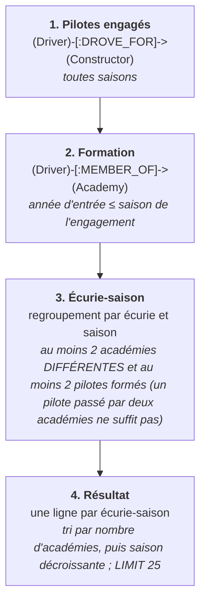

## Q13 — Which teams are connected by multiple independent paths, such as a coach, sponsor, executive, or former teammate?

**En clair.** Deux écuries peuvent être reliées de plusieurs façons : par un pilote qui a couru pour les deux, ou par une académie qui forme des pilotes pour l'une et en a placé un chez l'autre. On compte ces liens pour chaque paire d'écuries, et on montre celles qui en ont le plus, et de types différents.

*Couverture : PARTIELLE. Deux types de chemins existent dans les données : le PILOTE passé par les deux écuries, et l'ACADÉMIE qui alimente l'une et a formé un pilote de l'autre. Pas de sponsors ni de dirigeants dans les sources. Chemins indépendants = intermédiaires distincts ; types = nature des chemins.*

**Étape par étape.**

| Étape | Parcourt | Filtres |
|---|---|---|
| 1. Chemins par pilote | `(k1)<-[:DROVE_FOR]-(Driver)-[:DROVE_FOR]->(k2)` | k1 < k2 (chaque paire une fois) |
| 2. Chemins par académie | `(k1)<-[:FEEDS]-(Academy)<-[:MEMBER_OF]-(Driver)-[:DROVE_FOR]->(k2)` | k1 ≠ k2 ; paire remise en ordre k1 < k2 |
| 3. Regroupement | `par paire d'écuries` | intermédiaires distincts par type |
| 4. Résultat | `une ligne par paire` | total ≥ $chemins_min ; tri par nombre de types, puis total ; LIMIT 20 |

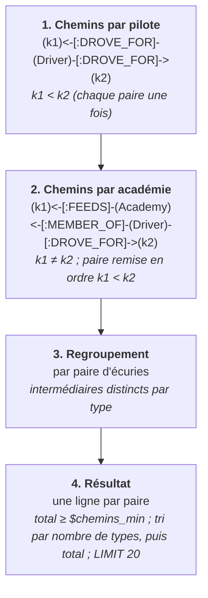

## Q14 — What documented links connect federation decision-makers, the executives of the teams involved, and their sponsors, either directly or through no more than three intermediaries?

**En clair.** Cette question demande des informations que personne ne publie sous une forme exploitable : les responsables de la FIA, les dirigeants des écuries, les sponsors. Plutôt que d'inventer des liens, elle reste sans réponse.

*Couverture : NON COUVERTE. Ni décideurs de la fédération (président de la FIA, directeur de course, commissaires), ni dirigeants d'écurie, ni sponsors dans des sources publiques structurées. Pistes : documents officiels de la FIA (décisions des commissaires, nominatifs), article Wikipédia « Formula One sponsorship liveries » (sponsors par écurie et par saison, tableaux hétérogènes).*

## Q15 — Do the champions of the past ten years belong to shared training and coaching networks, even if they never directly shared an organization?

**En clair.** On prend les champions du monde des dix dernières années. Pour chaque paire de champions, on regarde s'ils sont passés par une même écurie ou une même académie, puis on cherche le plus court « chemin » qui les relie dans le réseau des coéquipiers et des académies, comme le plus court trajet entre deux villes sur une carte.

*Couverture : complète, par substitution. Réseau de formation = académies (MEMBER_OF) ; réseau d'encadrement = coéquipiers (TEAMMATE_OF). Pour chaque paire de champions : académies de chacun, académie commune, organisation commune (écurie ou académie), et plus courte chaîne dans le réseau mêlant les deux.*

**Étape par étape.**

| Étape | Parcourt | Filtres |
|---|---|---|
| 1. Champions | `(Driver)-[:RANKED_IN]->(Season)` | position = 1 ; année < année courante ; année ≥ année courante − $saisons |
| 2. Paires | `champions × champions` | a.driverId < b.driverId |
| 3. Académies | `(Driver)-[:MEMBER_OF]->(Academy)` | pour chacun des deux |
| 4. Organisation commune | `EXISTS écurie commune OU académie commune` | à n'importe quelle époque |
| 5. Réseau commun | `shortestPath((a)-[:TEAMMATE_OF¦MEMBER_OF*..10]-(b))` | chemin non orienté, au plus 10 relations, passant par des pilotes ou des académies |

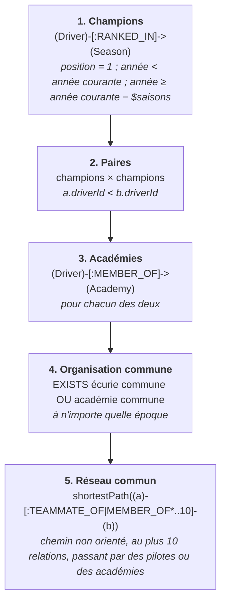

## Q16 — Do the two opponents have a shared history, such as a team, coach, training center, or mutual teammates? What indirect connections link them?

**En clair.** On prend les deux premiers du championnat. On liste tout ce qu'ils ont en commun : les saisons où ils étaient coéquipiers, les écuries et les académies par lesquelles ils sont passés tous les deux, les coéquipiers qu'ils ont eus en commun, et le plus court chemin qui les relie.

*Couverture : complète, par substitution. Écuries communes, saisons comme coéquipiers (encadrement partagé), académies communes (centre de formation), coéquipiers communs, et plus courte chaîne dans le réseau des coéquipiers et des académies.*

**Étape par étape.**

| Étape | Parcourt | Filtres |
|---|---|---|
| 1. Rivaux | `(prérequête) (Driver)-[:RANKED_IN]->(Season)` | dernière saison classée ; positions 1 et 2 |
| 2. Coéquipiers | `(a)-[:TEAMMATE_OF]-(b)` | saisons partagées |
| 3. Écuries communes | `(a)-[:DROVE_FOR]->(Constructor)<-[:DROVE_FOR]-(b)` | à n'importe quelle saison |
| 4. Académies communes | `(a)-[:MEMBER_OF]->(Academy)<-[:MEMBER_OF]-(b)` | avec les années de chacun |
| 5. Coéquipiers communs | `(a)-[:TEAMMATE_OF]-(Driver)-[:TEAMMATE_OF]-(b)` | intermédiaire distinct des deux |
| 6. Chaîne indirecte | `shortestPath((a)-[:TEAMMATE_OF¦MEMBER_OF*..10]-(b))` | non orientée, au plus 10 relations |

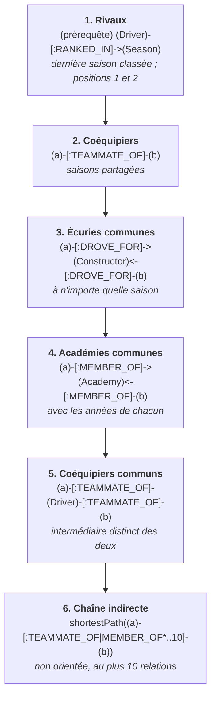

