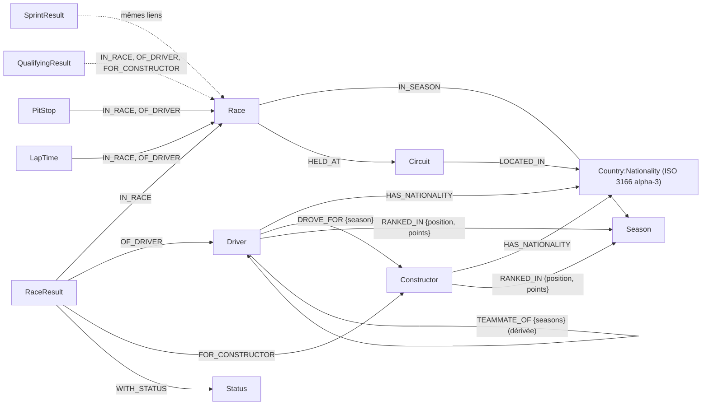

# Modèle du graphe F1

Base Neo4j des Grands Prix de Formule 1 depuis 1950, alimentée par l'API Jolpica-F1.
Le modèle ne contient **que ce que la source permet d'alimenter** : ni entraîneurs,
ni sponsors, ni dirigeants, qu'aucune source publique fiable ne fournit.

## Nœuds

| Étiquette | Clé (unique) | Principales propriétés | Volume indicatif |
|---|---|---|---|
| `Season` | `year` | `url` | 77 |
| `Circuit` | `circuitId` | `name`, `locality`, `latitude`, `longitude`, `location` (point WGS-84) | 78 |
| `Country:Nationality` | `iso3` | `name`, `officialName`, `nom` (fr), `nationality` (gentilé de l'API), `nationalite` (fr), `withdrawn` | 50 |
| `Driver` | `driverId` | `givenName`, `familyName`, `fullName`, `code`, `permanentNumber` (actuel), `dateOfBirth`, `url` | 881 |
| `Constructor` | `constructorId` | `name`, `url` | 214 |
| `Status` | `name` | | 136 |
| `Race` | `raceId` (`AAAA-RR`) ; unique aussi sur `(season, round)` | `name`, `date`, `startsAt`, dates et heures des séances | 1 172 |
| `RaceResult` | `resultId` (`AAAA-RR-numéro-pilote`) | `number`, `grid`, `position`, `positionText`, `points`, `laps`, `time`, `timeMillis`, meilleur tour | 26 000 |
| `SprintResult` | `resultId` | comme `RaceResult`, sans vitesse moyenne | 600 |
| `QualifyingResult` | `resultId` | `number`, `position`, `q1`…`q3`, `q1Millis`…`q3Millis` | 11 000 |
| `PitStop` | `pitStopId` (`AAAA-RR-pilote-arrêt`) | `stop`, `lap`, `timeOfDay`, `duration`, `durationMillis` | 13 000 |
| `LapTime` | `lapTimeId` (`AAAA-RR-pilote-tour`) | `lap`, `position`, `time`, `millis` | selon l'extraction |

### Pays et nationalités : un seul nœud ISO 3166 alpha-3

« France » (pays d'un circuit) et « French » (nationalité d'un pilote) sont **le même
nœud** `FRA`, porteur des deux étiquettes `:Country:Nationality`. Les libellés de l'API
(`UK`, `British`…) sont traduits par `referentiel/pays.csv`, table produite par le projet,
dont chaque code est vérifié contre la liste ISO 3166 du paquet iso-codes. Les noms
français des pays viennent d'iso-codes ; les gentilés français, de la table.

Deux codes **retirés** (ISO 3166-3) sont conservés pour l'histoire : `DDR` (pilotes
est-allemands) et `RHO` (pilotes rhodésiens), avec `withdrawn = true`.

## Relations

| Relation | De → vers | Cardinalité | Propriétés |
|---|---|---|---|
| `IN_SEASON` | `Race` → `Season` | exactement une | |
| `HELD_AT` | `Race` → `Circuit` | exactement une | |
| `LOCATED_IN` | `Circuit` → `Country` | au plus une | |
| `HAS_NATIONALITY` | `Driver`, `Constructor` → `Nationality` | au plus une | |
| `IN_RACE` | résultats, arrêts, tours → `Race` | exactement une | |
| `OF_DRIVER` | résultats, arrêts, tours → `Driver` | exactement une | |
| `FOR_CONSTRUCTOR` | résultats → `Constructor` | exactement une | |
| `WITH_STATUS` | `RaceResult`, `SprintResult` → `Status` | exactement une | |
| `DROVE_FOR` | `Driver` → `Constructor` | une par saison | `key`, `season` |
| `RANKED_IN` | `Driver`, `Constructor` → `Season` | une par saison | `key`, `position`, `positionText`, `points`, `wins`, `afterRound` |
| `TEAMMATE_OF` | `Driver` → `Driver` | une par paire | `key`, `seasons`, `constructors`, `firstSeason`, `lastSeason`, `seasonCount` |

`TEAMMATE_OF` est **dérivée** de `DROVE_FOR` (deux pilotes d'une même écurie la même
saison) et reconstruite à chaque chargement. Elle rend les recherches de chemins entre
pilotes instantanées (`shortestPath`), là où le motif pilote–écurie–pilote filtré sur la
saison prenait plus de dix minutes.

Les résultats sont des **nœuds** et non des relations, car un résultat réunit trois
entités (course, pilote, écurie) et un statut. Le numéro de voiture fait partie de leur
clé : dans les années 1950, un même pilote pouvait courir deux voitures dans une course.

## Contraintes et index

- **Unicité** (Community et Enterprise) : chaque clé ci-dessus, `(season, round)` des
  courses, et les clés des relations `DROVE_FOR`, `RANKED_IN`, `TEAMMATE_OF`
  (`schema/01_contraintes.cypher`).
- **Existence et type** (Enterprise seulement, `schema/02_contraintes_enterprise.cypher`).
  Sur Community, `charger.py` contrôle les mêmes règles après chaque chargement :
  cardinalités, codes ISO, cohérence de `TEAMMATE_OF`.
- **Index** (`schema/03_index.cypher`), chacun justifié par une requête de
  `schema/04_requetes.cypher` : dates et saisons des courses, positions, durée des arrêts,
  point géographique des circuits, recherche plein texte insensible aux accents sur les
  pilotes, écuries, circuits et pays (« francais » trouve `FRA`).
- **Migrations** (`schema/00_migrations.cypher`), idempotentes, appliquées en premier.

## Ce que la base ne contient pas, et pourquoi

| Absent | Raison |
|---|---|
| Entraîneurs, directeurs d'équipe, ingénieurs | Ni l'API ni Wikidata (1 écurie sur 629 avec un directeur renseigné) |
| Académies de pilotes | Absentes de l'API ; deux membres recensés dans Wikidata pour la Red Bull Junior Team |
| Sponsors, dirigeants, fédération | Aucune source publique structurée |
| Classements après chaque manche | Recalculés à la demande depuis les résultats (question 4) |
| Historique des numéros permanents | L'API ne donne que le numéro actuel |
