# Modèle relationnel équivalent au graphe Neo4j

Traduction, table par table, du graphe chargé par `charger.py`. Chaque table correspond
à une étiquette de nœud ou à une relation porteuse de propriétés. Les noms de colonnes
reprennent les propriétés du graphe en `snake_case`.

```mermaid
erDiagram
    SEASON ||--o{ RACE : "IN_SEASON"
    CIRCUIT ||--o{ RACE : "HELD_AT"
    COUNTRY ||--o{ CIRCUIT : "LOCATED_IN"
    NATIONALITY ||--o{ DRIVER : "HAS_NATIONALITY"
    NATIONALITY ||--o{ CONSTRUCTOR : "HAS_NATIONALITY"
    RACE ||--o{ RACE_SESSION : "horaires"

    RACE ||--o{ RACE_RESULT : "IN_RACE"
    DRIVER ||--o{ RACE_RESULT : "OF_DRIVER"
    CONSTRUCTOR ||--o{ RACE_RESULT : "FOR_CONSTRUCTOR"
    STATUS ||--o{ RACE_RESULT : "WITH_STATUS"

    RACE ||--o{ SPRINT_RESULT : "IN_RACE"
    DRIVER ||--o{ SPRINT_RESULT : "OF_DRIVER"
    CONSTRUCTOR ||--o{ SPRINT_RESULT : "FOR_CONSTRUCTOR"
    STATUS ||--o{ SPRINT_RESULT : "WITH_STATUS"

    RACE ||--o{ QUALIFYING_RESULT : "IN_RACE"
    DRIVER ||--o{ QUALIFYING_RESULT : "OF_DRIVER"
    CONSTRUCTOR ||--o{ QUALIFYING_RESULT : "FOR_CONSTRUCTOR"

    RACE ||--o{ PIT_STOP : "IN_RACE"
    DRIVER ||--o{ PIT_STOP : "OF_DRIVER"
    RACE ||--o{ LAP_TIME : "IN_RACE"
    DRIVER ||--o{ LAP_TIME : "OF_DRIVER"

    SEASON ||--o{ DRIVER_CONSTRUCTOR_SEASON : "DROVE_FOR"
    DRIVER ||--o{ DRIVER_CONSTRUCTOR_SEASON : "DROVE_FOR"
    CONSTRUCTOR ||--o{ DRIVER_CONSTRUCTOR_SEASON : "DROVE_FOR"
    SEASON ||--o{ DRIVER_STANDING : "RANKED_IN"
    DRIVER ||--o{ DRIVER_STANDING : "RANKED_IN"
    SEASON ||--o{ CONSTRUCTOR_STANDING : "RANKED_IN"
    CONSTRUCTOR ||--o{ CONSTRUCTOR_STANDING : "RANKED_IN"

    SEASON {
        integer year PK
        text url
    }
    COUNTRY {
        text name PK "libellé de l'API (UK, USA...)"
    }
    NATIONALITY {
        text name PK "gentilé (British...)"
    }
    CIRCUIT {
        text circuit_id PK
        text name
        text locality
        float latitude
        float longitude
        text country_name FK
        text url
    }
    DRIVER {
        text driver_id PK
        text given_name
        text family_name
        text full_name
        text code "non unique (MSC x2)"
        integer permanent_number "numéro actuel"
        date date_of_birth
        text nationality FK
        text url
    }
    CONSTRUCTOR {
        text constructor_id PK
        text name
        text nationality FK
        text url
    }
    STATUS {
        text name PK
    }
    RACE {
        text race_id PK "AAAA-RR"
        integer season FK "UK (season, round)"
        integer round "UK (season, round)"
        text circuit_id FK
        text name
        date date
        timestamptz starts_at
        text url
    }
    RACE_SESSION {
        text race_id PK, FK
        text session_type PK "first_practice, qualifying, sprint..."
        date date
        timestamptz starts_at
    }
    RACE_RESULT {
        text result_id PK "AAAA-RR-numero-pilote"
        text race_id FK
        text driver_id FK
        text constructor_id FK
        text status_name FK
        integer number "absent : 6 forfaits 1961-63"
        integer grid
        integer position
        text position_text
        float points
        integer laps
        text time
        integer time_millis
        integer fastest_lap_rank
        integer fastest_lap_number
        text fastest_lap_time
        integer fastest_lap_millis
        float fastest_lap_avg_speed_kph
    }
    SPRINT_RESULT {
        text result_id PK
        text race_id FK
        text driver_id FK
        text constructor_id FK
        text status_name FK
        integer number
        integer grid
        integer position
        text position_text
        float points
        integer laps
        text time
        integer time_millis
        integer fastest_lap_rank
        integer fastest_lap_number
        text fastest_lap_time
        integer fastest_lap_millis
    }
    QUALIFYING_RESULT {
        text result_id PK
        text race_id FK
        text driver_id FK
        text constructor_id FK
        integer number
        integer position
        text q1
        integer q1_millis
        text q2
        integer q2_millis
        text q3
        integer q3_millis
    }
    PIT_STOP {
        text race_id PK, FK
        text driver_id PK, FK
        integer stop PK
        integer lap
        time time_of_day "heure locale"
        text duration
        integer duration_millis
    }
    LAP_TIME {
        text race_id PK, FK
        text driver_id PK, FK
        integer lap PK
        integer position
        text time
        integer millis
    }
    DRIVER_CONSTRUCTOR_SEASON {
        integer season PK, FK
        text driver_id PK, FK
        text constructor_id PK, FK
    }
    DRIVER_STANDING {
        integer season PK, FK
        text driver_id PK, FK
        integer after_round
        integer position "absent si exclu (D, E, -)"
        text position_text
        float points
        integer wins
    }
    CONSTRUCTOR_STANDING {
        integer season PK, FK
        text constructor_id PK, FK
        integer after_round
        integer position
        text position_text
        float points
        integer wins
    }
```

## Correspondance graphe → tables

| Graphe Neo4j | Relationnel |
|---|---|
| Nœud `Season`, `Circuit`, `Country`, `Nationality`, `Driver`, `Constructor`, `Status`, `Race` | Une table chacun, clé primaire = clé d'unicité du graphe |
| Relation un-à-un ou plusieurs-à-un (`IN_SEASON`, `HELD_AT`, `LOCATED_IN`, `HAS_NATIONALITY`) | Clé étrangère dans la table de départ |
| Nœuds n-aires `RaceResult`, `SprintResult`, `QualifyingResult` | Tables de résultats ; leurs relations `IN_RACE`, `OF_DRIVER`, `FOR_CONSTRUCTOR`, `WITH_STATUS` deviennent des clés étrangères |
| `PitStop`, `LapTime` | Tables à clé primaire composite `(race_id, driver_id, stop)` ou `(race_id, driver_id, lap)`, qui remplace la clé texte concaténée du graphe |
| Relation `DROVE_FOR {season}` | Table d'association `driver_constructor_season` |
| Relations `RANKED_IN` (pilote, constructeur) | Tables `driver_standing` et `constructor_standing`, une ligne par saison |
| Propriétés `firstPracticeDate`, `qualifyingStartsAt`… de `Race` | Table `race_session`, une ligne par séance : 14 colonnes souvent vides deviennent des lignes présentes seulement quand la séance existe |

## Différences assumées

- **Clés des résultats** : `result_id` reste une clé texte de substitution. La clé
  naturelle `(race_id, number, driver_id)` ne peut pas servir de clé primaire, car
  `number` est absent pour six engagés forfaits (1961-1963). Une contrainte
  `UNIQUE (race_id, number, driver_id)` reste possible, puisque les `NULL` ne s'y
  comparent pas.
- **Point géographique** : `Circuit.location` (type `POINT`) n'existe pas en SQL
  standard. Restent `latitude` et `longitude`, ou une colonne `geography(Point)` sous
  PostGIS.
- **Contraintes que Neo4j Community n'impose pas** : la cardinalité « exactement une
  course, un pilote, une écurie par résultat », vérifiée après coup par `charger.py`,
  devient ici des clés étrangères `NOT NULL`, imposées par le moteur.
